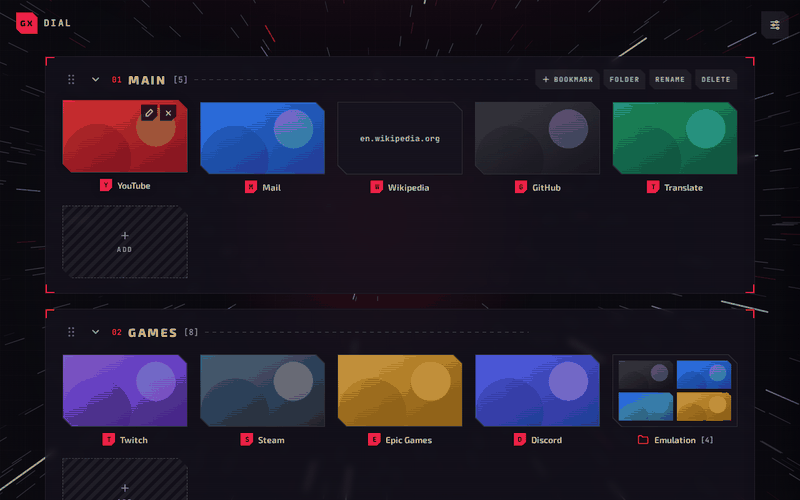
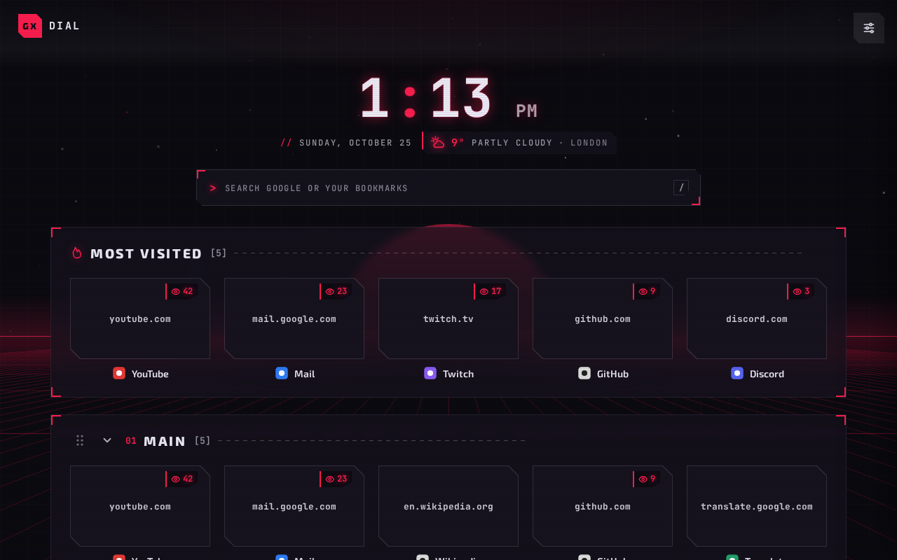
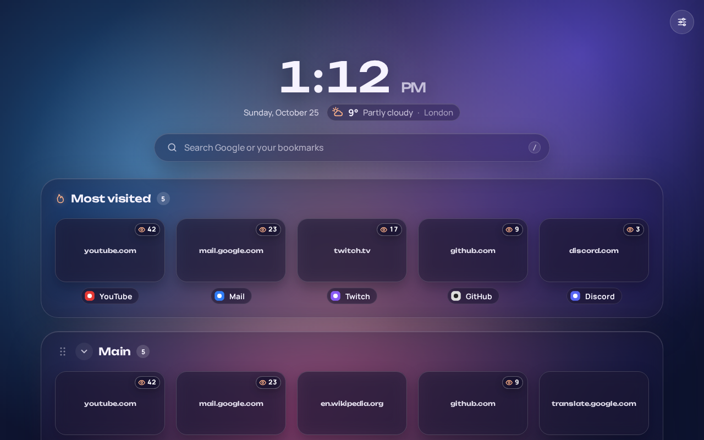
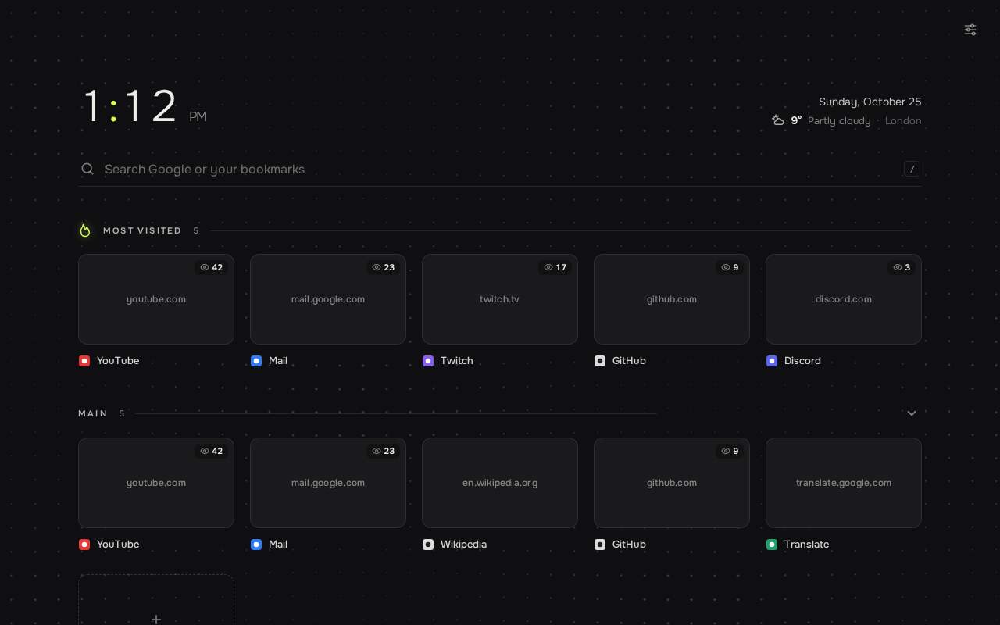
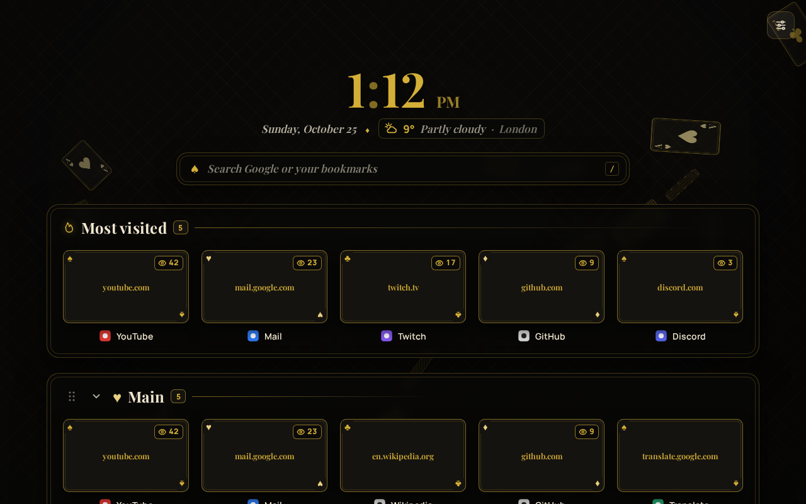
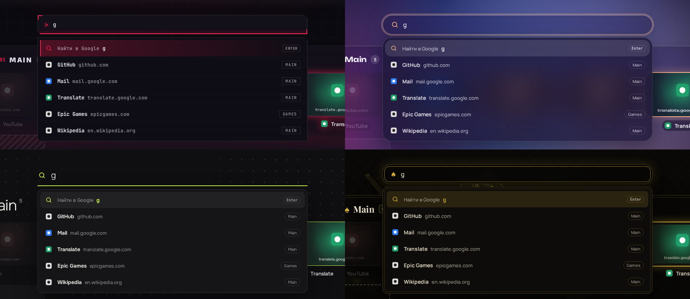
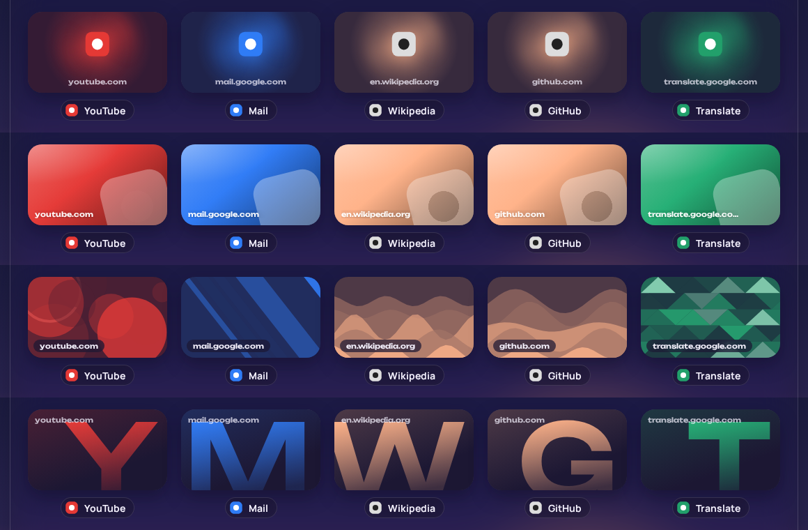
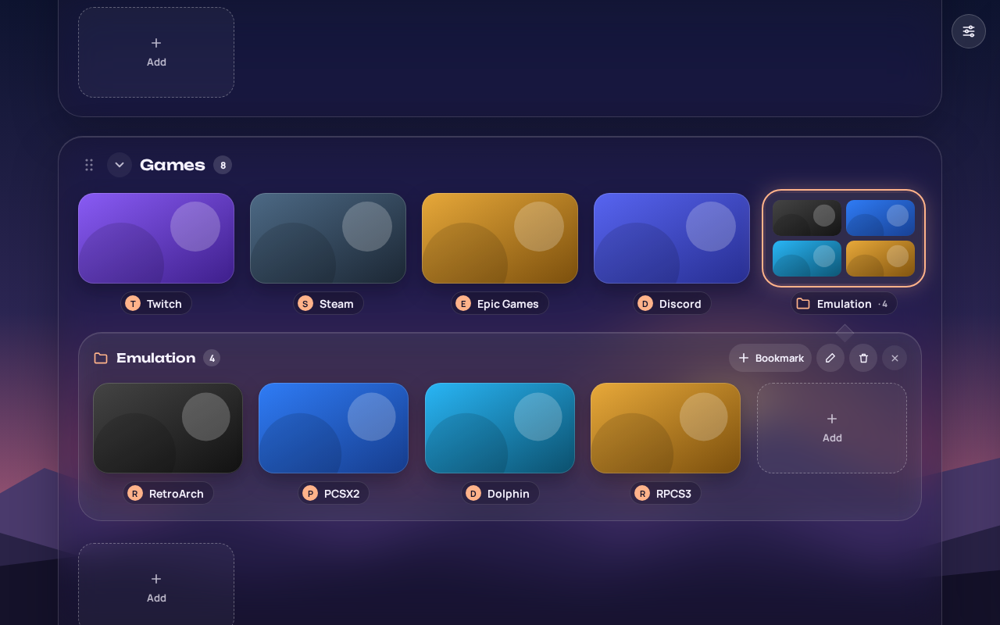
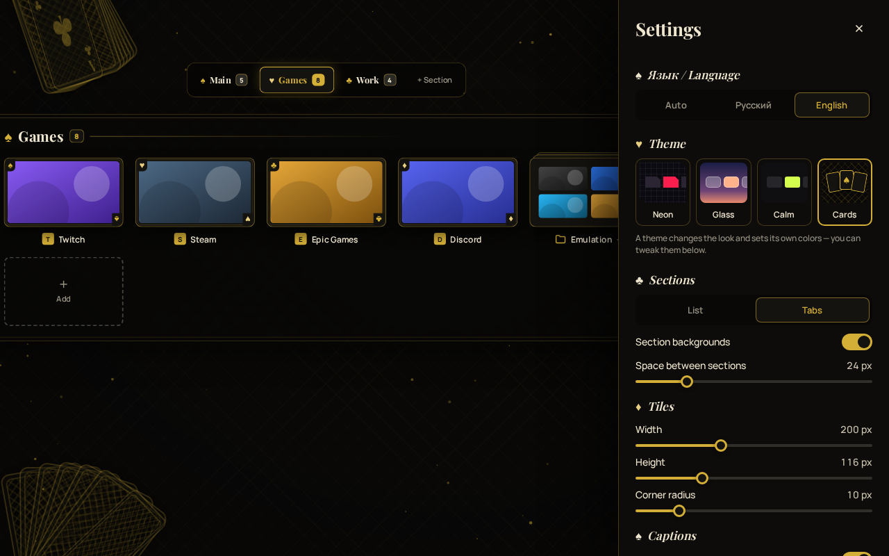

# GX Dial

**A customizable speed dial for Opera GX** — sections, folders, your own tile images,
four themes and live animated backgrounds.

[Русская версия](README.ru.md) · [Download](https://github.com/ArmaGhetton/GXDial/releases/latest) · [Changelog](CHANGELOG.md)

> The interface is in **English** and **Russian** — it follows your browser language, and you can switch it in Settings → *Language*.

## Features

- **Sections** — group your bookmarks; show them as a list or as tabs. Rename, collapse, reorder by drag & drop.
- **Folders inside sections** — a folder looks like a tile with a 2×2 preview and unfolds right under its row. Drop a tile onto a folder to put it inside.
- **Search bar** — searches Google and your bookmarks at once: just start typing anywhere, matching tiles light up. Type an address to open it directly. Styled to match each theme.
- **Drag & drop everywhere** — reorder tiles, move them between sections, folders and tabs.
- **Your own images on tiles** — from your computer or by URL, *cover* or *contain*.
- **Covers for tiles without an image** — the site address, a big glowing icon, the site's own color, a unique generated pattern or a giant letter. The color is taken from the site's icon; each site gets its own pattern.
- **Four themes**, each with its own fonts, animations and settings panel:
  - **Neon** — gaming HUD in the spirit of Opera GX: chamfered corners, glow, glitch.
  - **Glass** — frosted panels over your wallpaper, 3D tilt on hover.
  - **Calm** — minimalism and big light typography.
  - **Cards** — black and gold playing cards with suits in the corners.
- **Live animated backgrounds** when no wallpaper is set — 2–3 per theme (retro horizon, hexagons, hyperjump, flowing blobs, silk, dot waves, constellations, flying cards, suits, card fans). They react to the cursor.
- **Theme-specific transitions** when you open a site: glitch, glass zoom, ink wipe, card flip.
- **Fully adjustable** — tile size, corner radius, grid columns and gaps, captions, colors, wallpaper with dim and blur.
- **Import** an Opera bookmarks folder as a section (subfolders become folders).
- Works offline: all fonts are bundled, nothing is loaded from the internet.

## Themes

| Neon | Glass |
|:---:|:---:|
|  |  |
| **Calm** | **Cards** |
|  |  |

### Search

### Covers for tiles without an image

Icon · Site color · Pattern · Letter

| Folders | Tabs and settings |
|:---:|:---:|
|  |  |

## Installation

1. Download `GXDial-vX.Y.Z.zip` from the [latest release](https://github.com/ArmaGhetton/GXDial/releases/latest) and unzip it to a permanent folder.
2. Open `opera://extensions` and turn on **Developer mode** (top right).
3. Click **Load unpacked** and choose the `GXDial` folder (the one with `manifest.json` inside).
4. Open a new tab — done.

> Don't move or rename the folder later: the browser ties the extension and its saved data to that location.

### Open GX Dial right when Opera starts

Opera always shows its own start page first, so for a second you may see the default tiles. To avoid that:

1. Open `opera://settings/onStartup` and choose **Open a specific page or set of pages**.
2. Add the address of your dial — copy it in GX Dial: **Settings → Other → When Opera starts → Copy**.
3. If there is a switch like *Show the start page first*, turn it off.

### Updating

Replace the files in your `GXDial` folder with the new ones and press the reload button on the GX Dial card in `opera://extensions`. Bookmarks, sections, images and settings are kept.

## Good to know

- **The address bar shows `chrome-extension://…`.** Opera doesn't let extensions hide it or leave it empty, the same as with every other new-tab extension in Opera. Press `F8` or `Ctrl+L` to type an address right away.
- **Other browsers.** GX Dial is made for Opera GX, but it also runs in Chrome and other Chromium-based browsers through *Load unpacked*.
- **Privacy.** Everything — bookmarks, images, settings — is stored only in your browser (`chrome.storage.local`). The extension sends nothing anywhere and has no analytics.

### Permissions

| Permission | Why |
|---|---|
| `tabs` | to replace Opera's start page with the dial in new tabs |
| `storage`, `unlimitedStorage` | to keep your bookmarks, settings and tile images locally |
| `bookmarks` | to import an Opera bookmarks folder as a section |
| `favicon` | to show site icons from the browser's own cache |
| `alarms` | to keep the background part awake so new tabs open instantly |

## License

Code: [MIT](LICENSE). Bundled fonts (Exo 2, JetBrains Mono, Manrope, Onest, Playfair Display, Unbounded) are under the SIL Open Font License 1.1 — see [`GXDial/fonts/LICENSE-OFL.txt`](GXDial/fonts/LICENSE-OFL.txt).

GX Dial is an independent project and is not affiliated with Opera.
